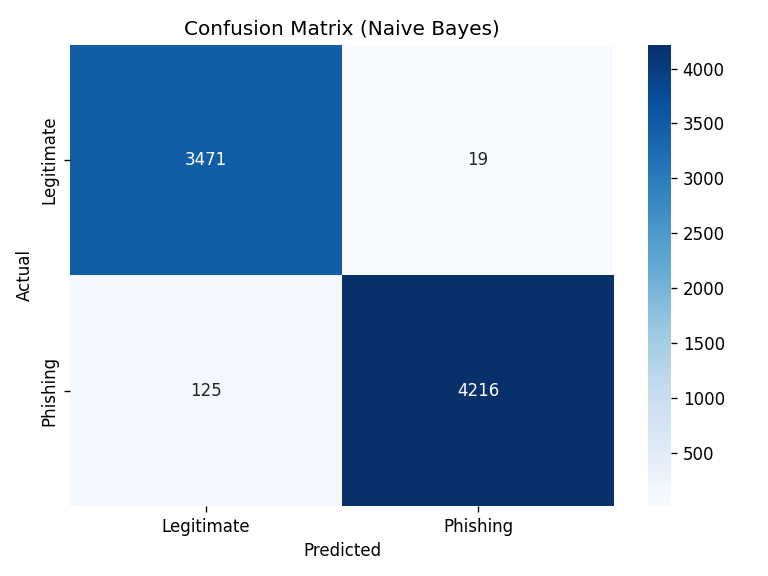
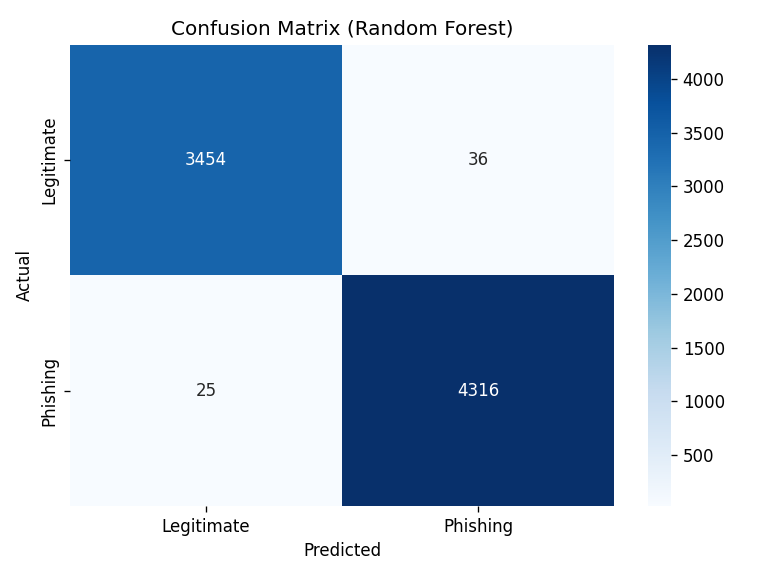
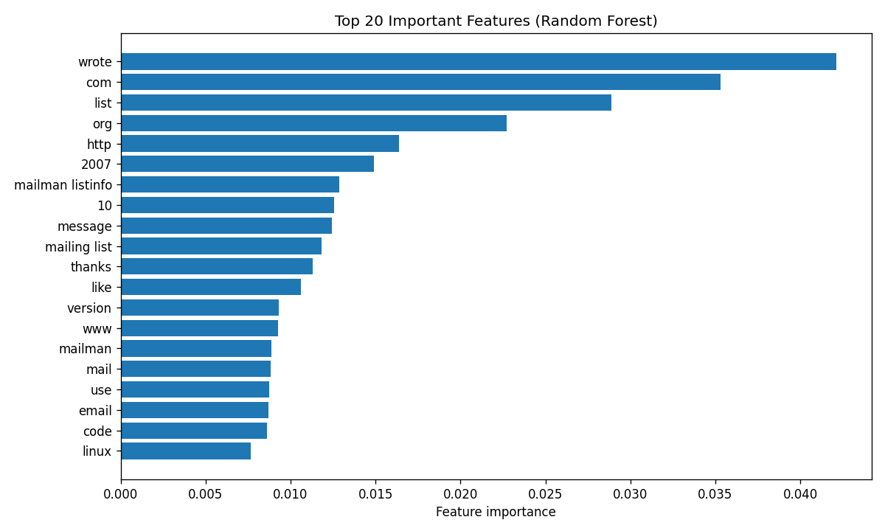

# Machine Learning Phishing Email Detection

Detecting phishing emails from their text with two supervised models, Multinomial Naïve Bayes and
Random Forest, trained on TF-IDF features. MSc Cyber Security project, University of Hertfordshire (2025).

**Result:** Random Forest catches 99.4% of phishing emails with 99.2% precision. Compared with
Naïve Bayes it misses 5× fewer phishing emails (25 vs 125), at the cost of more false alarms (36 vs 19).

## Dataset

**CEAS 2008** (`CEAS_08.csv`, from Kaggle): 39,154 emails, 21,842 phishing (`label = 1`) and
17,312 legitimate (`label = 0`). The models use the email `body` text only.

The dataset is not included in this repo. Download `CEAS_08.csv` from Kaggle, check its licence,
and put it at `data/CEAS_08.csv`.

## Method

1. Load the emails and drop rows with missing text or label.
2. Split 80:20 into training and test sets (`random_state=42`, so both models see the same 7,831 test emails).
3. Convert text to TF-IDF features (5,000 features, English stop words removed; the Random Forest also uses bigrams).
4. Train Multinomial Naïve Bayes and a Random Forest (100 trees).
5. Compare them with precision, recall, accuracy and confusion matrices.

## Results

On the 7,831 test emails (4,341 phishing, 3,490 legitimate):

| Metric (phishing class) | Naïve Bayes | Random Forest |
|---|---:|---:|
| Precision | 99.6% | 99.2% |
| Recall | 97.1% | 99.4% |
| Accuracy (overall) | 98.2% | 99.2% |
| Phishing missed (false negatives) | 125 | 25 |
| Legitimate flagged (false positives) | 19 | 36 |

**What this means:** Random Forest is the better phishing filter. A missed phishing email can lead to
a compromise, so cutting misses from 125 to 25 matters more than the 17 extra legitimate emails it
flags for review. Naïve Bayes is more conservative: when it says "phishing" it is almost always
right, but it lets more phishing through.

| Naïve Bayes | Random Forest |
|---|---|
|  |  |

## Limitations: what the model actually learned



The most important features are mailing-list words: "wrote", "mailman listinfo", "mailing list",
"linux", "2007". Most legitimate emails in CEAS 2008 come from public mailing lists, so part of
what the model learns is "is this a mailing-list email?" rather than "is this phishing?". Accuracy on
a real organisation's inbox would likely be lower.

Ways to improve:

- Test on a second, more recent dataset to check the model generalises.
- Add header and sender features (SPF/DKIM results, display-name spoofing, reply-to mismatch).
- Analyse URLs: domain age, lookalike domains, URL shorteners.
- Try transformer models (e.g. BERT) on the same split.
- Feed predictions into a SIEM as an enrichment signal rather than a standalone verdict.

## Run it

```bash
pip install -r requirements.txt
python naive_bayes.py          # reads data/CEAS_08.csv, writes results/confusion_matrix_naive_bayes.png
python random_forest.py        # writes the Random Forest confusion matrix and top-features chart
```

Pass a different path as the first argument if your CSV is elsewhere.
